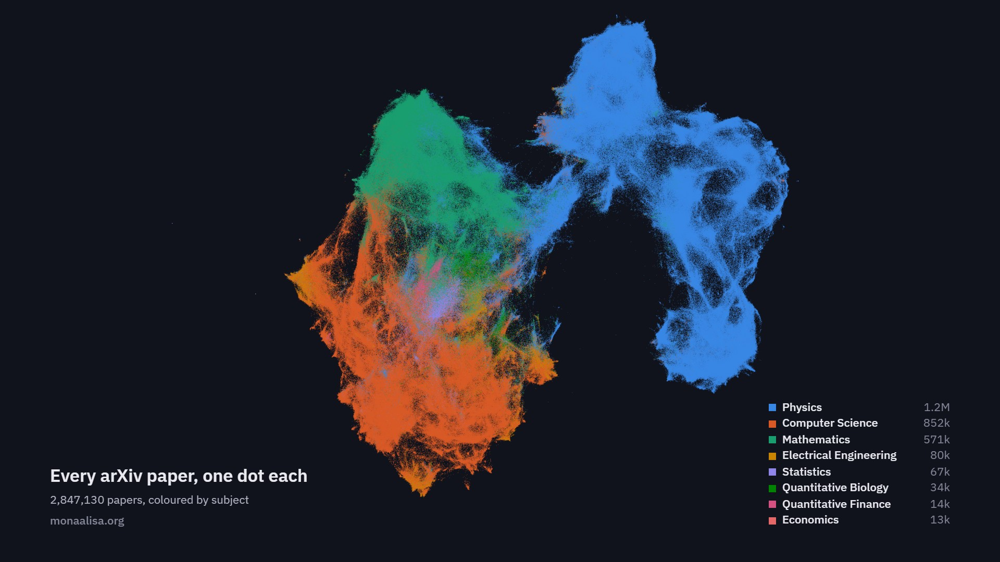

# Monaa-Lisa

**A tool for visualizing Open Access literature, developed as part of the 2025 Software Project at Hochschule Bochum (Bochum University of Applied Sciences).**

## Quickstart (Development)

**Note:**

- You must have a valid `.env` file before starting!!

1. **Copy the example environment file:**

    ```sh
    cp .env.example .env
    # Edit .env and set your own DB user, password, and database name - This has to be set otherwise nothing will run.
    ```

2. **Start the development environment (Docker Compose):**

    ```sh
    docker-compose up --build
    ```

3. **Access the app:**
    - Frontend: http://localhost:5173
    - Database: localhost:5432 (Postgres)

## License

Unless otherwise stated, all files in this repository are licensed under the **GNU Affero General Public License v3 (AGPL-3.0)**.

See the [LICENSE](LICENSE) file for the full license text.
